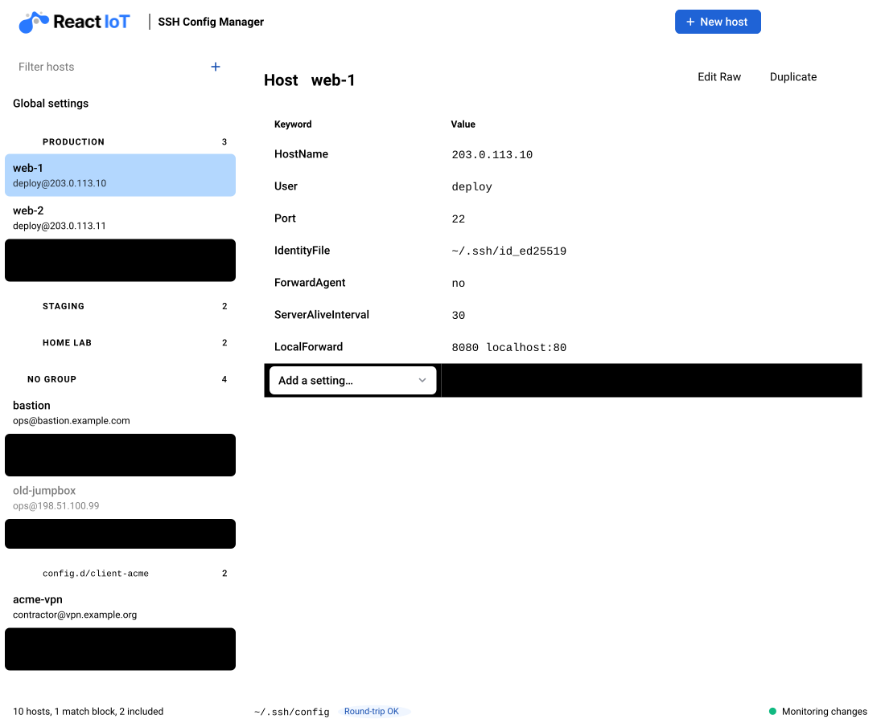
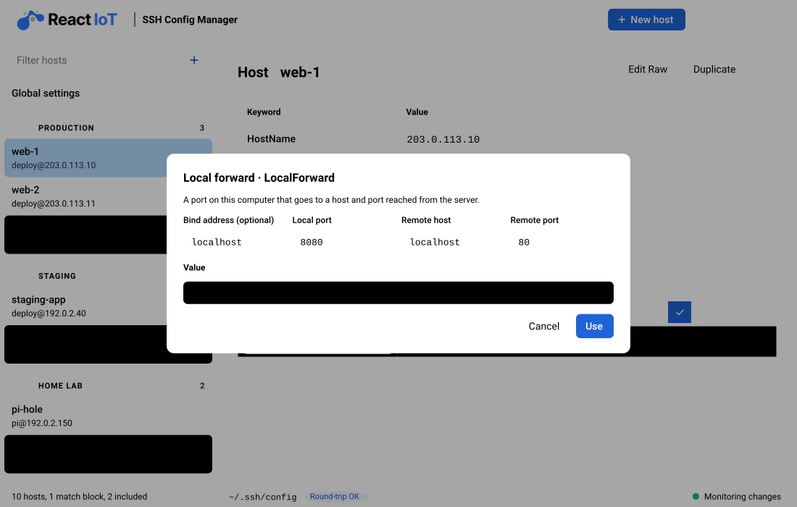
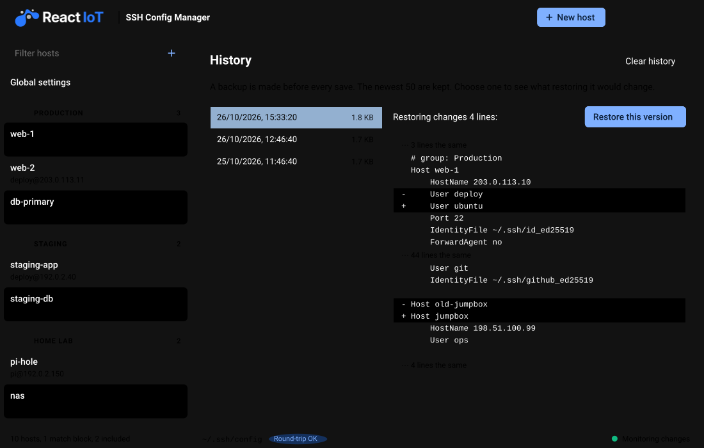
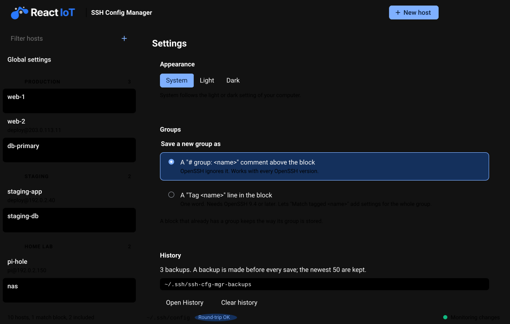

<p align="center">
  <a href="https://reactiot.com.au">
    <picture>
      <source media="(prefers-color-scheme: dark)" srcset="ui/assets/logo-lockup-horizontal-dark.svg" />
      
    </picture>
  </a>
</p>

# SSH Config Manager

[](https://github.com/react-iot/ssh-cfg-mgr/actions/workflows/ci.yml)
[](https://github.com/react-iot/ssh-cfg-mgr/actions/workflows/release.yml)
[](https://github.com/react-iot/ssh-cfg-mgr/releases/latest)
[](https://github.com/react-iot/ssh-cfg-mgr/releases/latest)
[](LICENSE)
[](https://github.com/sponsors/react-iot)

A free, open-source desktop app for macOS, Linux and Windows that manages your
`~/.ssh/config` file and SSH keys. Made by [ReactIoT](https://reactiot.com.au).

**[Download](https://github.com/react-iot/ssh-cfg-mgr/releases/latest)** ·
[Product page](https://reactiot.com.au/products/ssh-config-manager) ·
[Report an issue](https://github.com/react-iot/ssh-cfg-mgr/issues) ·
[Sponsor](https://github.com/sponsors/react-iot)

**Status:** early development. You can view, add, edit and delete `Host`
and `Match` blocks, and sort and group them. The SSH keys view lists the
keys in `~/.ssh` and the hosts that use each one, copies a public key, and
makes a new Ed25519 key. Global settings (the lines before the first
`Host`) can be edited the same way.

<picture>
  <source media="(prefers-color-scheme: dark)" srcset="docs/ui-dark.svg" />
  
</picture>

Edit a value in place. Values with several parts, such as `LocalForward`,
have a builder:



Every save makes a backup. History shows what restoring one would change:





The images are made from the app with made-up data (`example.com` names
and documentation IP addresses).

## How a save works

The app never leaves your config half-written or broken:

1. It checks that the file did not change after you opened it (for
   example, in an editor). If it changed, nothing is saved.
2. It writes the new text to a temporary file in the same folder, with the
   same permissions as the old file (`0600` for a new file).
3. It runs `ssh -G -F <temp file>`. If OpenSSH rejects the file, nothing
   is saved and the error is shown.
4. It copies the old file to `~/.ssh/ssh-cfg-mgr-backups/` (the newest 50
   backups are kept).
5. It renames the temporary file over the config. A rename is atomic.

Only the lines you changed are different. Comments, blank lines,
indentation and the order of lines stay. If `~/.ssh/config` is a symlink
(for example, from a dotfiles manager), the app writes to the real file and
keeps the link.

The **History** button lists these backups. Choose one to see what
restoring it would change (a line diff), then restore it. A restore is a
normal save: it is checked with `ssh -G`, and the file before the restore
is backed up too, so a restore can be undone.

New hosts go before `Host *`, because OpenSSH uses the first value it
finds for each keyword.

## Turning a host off

The eye button on each row turns a block off or on. Off adds `#~` to the
start of the block's lines, so OpenSSH reads them as comments:

```
#~Host old-server
#~    HostName 10.0.0.9
```

On removes the `#~` again, so you get back exactly the text you had. The
app uses `#~`, not plain `#`, because a normal comment can also start with
`# Host`.

## Include files

Hosts in files brought in by `Include` are listed in their own section,
one per file. Files inside `~/.ssh` can be edited like the main config
(each save is checked with `ssh -G` and backed up next to that file).
Files outside `~/.ssh`, such as `~/.orbstack/ssh/config`, are managed by
other apps and stay read-only. The app follows OpenSSH's rules: several paths
per line, wildcards in lexical order, `~`, `${VAR}`, and relative paths
in `~/.ssh`. An `Include` inside a `Host` or `Match` block is shown with
"only for ...". A path with a token such as `%h` depends on the host, so
it is shown with that reason instead. A save is checked with `ssh -G`,
which also reads the included files.

## Host groups

You can put each `Host` or `Match` block in a group. The sidebar shows
the groups as sections. The app reads the group from the file, in one of
two forms:

| Form | In the file | Notes |
|---|---|---|
| Comment (default) | `# group: Work` on the line above the block | OpenSSH ignores comments. Works with every OpenSSH version. |
| Tag | `Tag work` in the block | One word. Needs OpenSSH 9.4 or later. You can use `Match tagged work` for settings that apply to the whole group. |

A block that already has a group keeps its form. A new group uses the
form you choose in Settings (the gear button). Settings and the sort
order are kept on your computer, not in the config.

## Goals

- Edit `~/.ssh/config` with a GUI **without changing anything you did not
  edit**: comments, order, indentation and line endings stay.
- Show all SSH keys, which hosts use them, and keys that no host uses.
- Check the config with OpenSSH (`ssh -G`) before every save, and keep a
  backup of every version.
- Keep everything on your computer. No account, no cloud, no telemetry.

## Project layout

| Path | Contents |
|---|---|
| `crates/sshconfig-lossless` | Rust library: reads and writes ssh_config files without loss |
| `src-tauri/` | Tauri 2 app: Rust commands that the UI calls |
| `ui/` | The UI: plain HTML, CSS and JavaScript, no build step |

## Install

Download the file for your system from
[Releases](https://github.com/react-iot/ssh-cfg-mgr/releases):

| System | File | How to install |
|---|---|---|
| macOS (Apple silicon and Intel) | `.dmg` | Open it, drag the app to Applications |
| Debian, Ubuntu | `.deb` | `sudo apt install ./<file>.deb` |
| Fedora, RHEL, openSUSE | `.rpm` | `sudo dnf install ./<file>.rpm` |
| Other Linux | `.AppImage` | `chmod +x` the file, then run it |
| Windows 10 and 11 (x64) | `.msi` or `-setup.exe` | Run it. The app is not signed yet, so SmartScreen asks first: More info > Run anyway |

Linux files are for x86_64 (`amd64`, `x86_64`) and ARM64 (`arm64`,
`aarch64`). Choose the one for your CPU (`uname -m`).

On Windows the app needs the OpenSSH client (`ssh.exe`, `ssh-keygen.exe`).
It comes with Windows 10 and 11; if it is missing, add it in Settings >
System > Optional features > OpenSSH Client.

To make a release, see [docs/RELEASING.md](docs/RELEASING.md).

## Build and test

You need:

- Rust (install it with [rustup](https://rustup.rs))
- Node.js, only for the Tauri command-line tool
- On Linux, the WebKitGTK libraries. On Ubuntu/Debian:
  ```sh
  sudo apt install libwebkit2gtk-4.1-dev libsoup-3.0-dev libgtk-3-dev librsvg2-dev libayatana-appindicator3-dev
  ```
- On macOS, the Xcode command-line tools (`xcode-select --install`)

```sh
npm install                    # installs the Tauri CLI
npm run dev                    # start the app
npm run build                  # make an installer (.dmg, .deb, .AppImage, ...)

cargo test                     # run all tests
cargo clippy --all-targets     # lint
cargo run --example list_hosts # list the hosts in your ~/.ssh/config
node scripts/preview.js        # the UI in a browser, with a fake Tauri API
```

The UI is native custom elements (light DOM, ES modules): `ui/store.js`
holds the state and every call to Rust and emits `change`; `ui/main.js`
draws the components in `ui/components/` from it.

To try the app on a copy instead of your real config, set
`SSH_CFG_MGR_CONFIG`:

```sh
cp ~/.ssh/config /tmp/test_config
SSH_CFG_MGR_CONFIG=/tmp/test_config npm run dev
```

## Support

SSH Config Manager is free. If it saves you time, you can
[sponsor ReactIoT on GitHub](https://github.com/sponsors/react-iot). Sponsors
pay for the Apple Developer account that signs and notarizes the macOS app.

## Licence

Apache License 2.0. See [LICENSE](LICENSE).

## Contributing

See [CONTRIBUTING.md](CONTRIBUTING.md). Every commit needs a DCO sign-off
(`git commit -s`).
