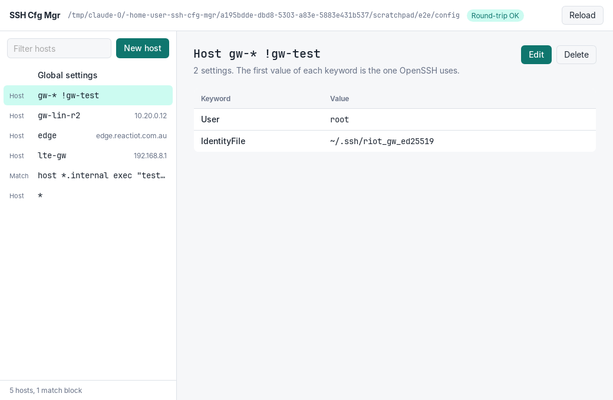
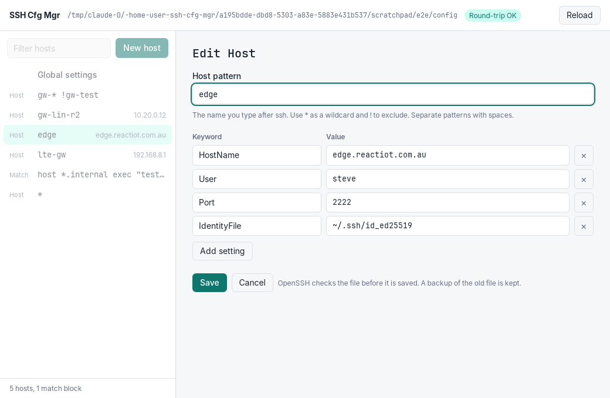

# SSH Cfg Mgr

A free, open-source desktop app for macOS and Linux that manages your
`~/.ssh/config` file and SSH keys. Made by ReactIoT.

**Status:** early development. You can view, add, edit and delete `Host`
and `Match` blocks, and sort and group them. Global settings are read-only
for now.





## How a save works

The app never leaves your config half-written or broken:

1. It checks that the file did not change after you opened it (for
   example, in an editor). If it changed, nothing is saved.
2. It writes the new text to a temporary file in the same folder, with the
   same permissions as the old file (`0600` for a new file).
3. It runs `ssh -G -F <temp file>`. If OpenSSH rejects the file, nothing
   is saved and the error is shown.
4. It copies the old file to `~/.ssh/ssh-cfg-mgr-backups/` (the newest 50
   backups are kept).
5. It renames the temporary file over the config. A rename is atomic.

Only the lines you changed are different. Comments, blank lines,
indentation and the order of lines stay. If `~/.ssh/config` is a symlink
(for example, from a dotfiles manager), the app writes to the real file and
keeps the link.

New hosts go before `Host *`, because OpenSSH uses the first value it
finds for each keyword.

## Host groups

You can put each `Host` or `Match` block in a group. The sidebar shows
the groups as sections. The app reads the group from the file, in one of
two forms:

| Form | In the file | Notes |
|---|---|---|
| Comment (default) | `# group: Work` on the line above the block | OpenSSH ignores comments. Works with every OpenSSH version. |
| Tag | `Tag work` in the block | One word. Needs OpenSSH 9.4 or later. You can use `Match tagged work` for settings that apply to the whole group. |

A block that already has a group keeps its form. A new group uses the
form you choose in Settings (the gear button). Settings and the sort
order are kept on your computer, not in the config.

## Goals

- Edit `~/.ssh/config` with a GUI **without changing anything you did not
  edit**: comments, order, indentation and line endings stay.
- Show all SSH keys, which hosts use them, and keys that no host uses.
- Check the config with OpenSSH (`ssh -G`) before every save, and keep a
  backup of every version.
- Keep everything on your computer. No account, no cloud, no telemetry.

## Project layout

| Path | Contents |
|---|---|
| `crates/sshconfig-lossless` | Rust library: reads and writes ssh_config files without loss |
| `src-tauri/` | Tauri 2 app: Rust commands that the UI calls |
| `ui/` | The UI: plain HTML, CSS and JavaScript, no build step |

## Build and test

You need:

- Rust (install it with [rustup](https://rustup.rs))
- Node.js, only for the Tauri command-line tool
- On Linux, the WebKitGTK libraries. On Ubuntu/Debian:
  ```sh
  sudo apt install libwebkit2gtk-4.1-dev libsoup-3.0-dev libgtk-3-dev librsvg2-dev libayatana-appindicator3-dev
  ```
- On macOS, the Xcode command-line tools (`xcode-select --install`)

```sh
npm install                    # installs the Tauri CLI
npm run dev                    # start the app
npm run build                  # make an installer (.dmg, .deb, .AppImage, ...)

cargo test                     # run all tests
cargo clippy --all-targets     # lint
cargo run --example list_hosts # list the hosts in your ~/.ssh/config
```

To try the app on a copy instead of your real config, set
`SSH_CFG_MGR_CONFIG`:

```sh
cp ~/.ssh/config /tmp/test_config
SSH_CFG_MGR_CONFIG=/tmp/test_config npm run dev
```

## Licence

Apache License 2.0. See [LICENSE](LICENSE).

## Contributing

See [CONTRIBUTING.md](CONTRIBUTING.md). Every commit needs a DCO sign-off
(`git commit -s`).
